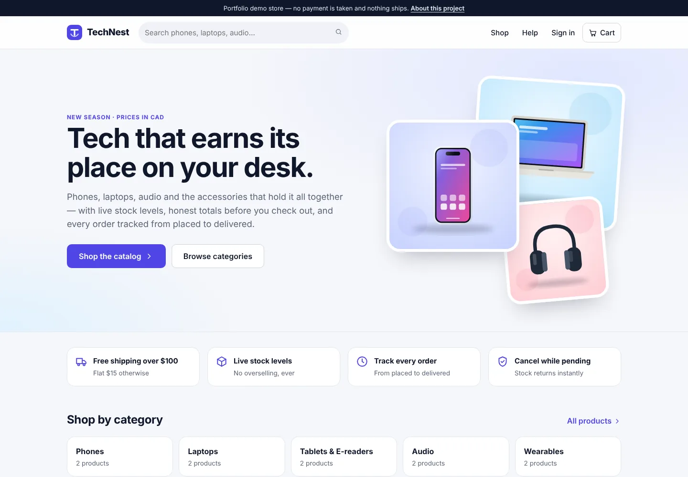
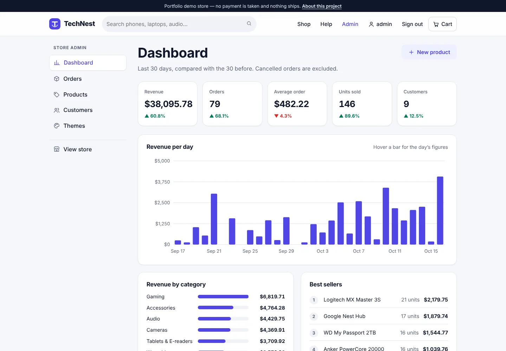
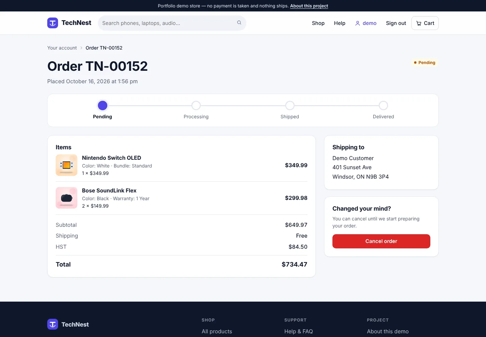
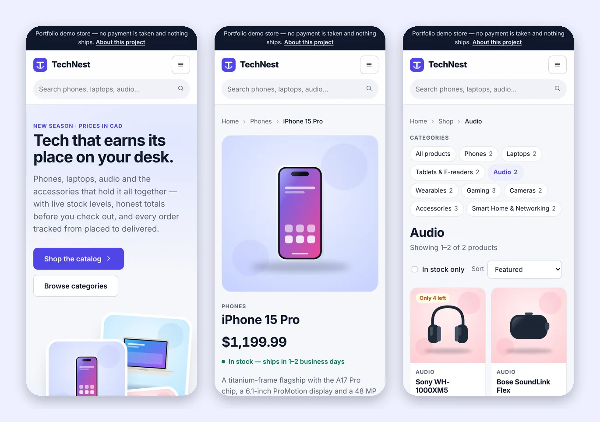

# TechNest

[](https://github.com/brettadams0/TechNest/actions/workflows/ci.yml)
[](https://www.php.net/)
[](phpstan.neon.dist)
[](database/migrations)
[](LICENSE)

A complete electronics store in framework-free PHP: catalog, cart, a transactional checkout, an
order lifecycle with an audit trail, and an admin dashboard with sales analytics. There is no
framework and no runtime dependency, so the routing, sessions, SQL and security controls are all in
the code where you can read them, rather than behind a library.

It started as university coursework and was rebuilt to the standard I would want a reviewer to hold
it to — [what changed](#what-changed-from-the-coursework-version) is listed below.



| Admin dashboard | Order tracking | Phone |
|---|---|---|
|  |  |  |

## Run it

Needs PHP 8.2+ with `pdo_sqlite`, and Composer.

```sh
git clone https://github.com/brettadams0/TechNest.git && cd TechNest
composer install
composer setup    # creates var/technest.sqlite, the catalog, demo accounts and 10 weeks of orders
composer serve    # http://127.0.0.1:8000
```

| Demo account | Username | Password |
|---|---|---|
| Customer (has orders to look at) | `demo` | `technest-demo` |
| Administrator | `admin` | `technest-admin` |

These accounts exist only because `APP_ENV` is not `production`; the seeder refuses to create them
otherwise.

**With Docker and MySQL** — Apache, PHP 8.3 and MySQL 8.4, migrated and seeded on start:

```sh
docker compose up --build    # http://localhost:8080
```

## What it does

**Storefront.** Search, category filters, sorting and pagination. Products have option groups
(colour, storage, warranty…) with the price updating as you choose. The cart is re-priced against the
live catalog on every view and tells you if anything changed — an item archived, an option removed,
stock running low. Checkout validates a Canadian address, adds shipping and 13% HST, and places the
order. Customers track each order through its states and can cancel it until it starts processing.

**Admin.** A dashboard of the last 30 days against the 30 before — revenue, orders, average order
value, units, customers — with revenue per day, revenue by category, best sellers, orders by status
and low-stock alerts. Orders move through an enforced lifecycle with a full history of who changed
what. Products are created, edited, given options and archived (never deleted). Customer accounts
can be disabled or promoted to admin, and the store's theme switched for every visitor.

## Engineering notes

The parts worth reading, and where to find them:

- **Checkout is a single transaction** — [`CheckoutService`](src/Checkout/CheckoutService.php). It
  re-prices the cart from the database (the session holds only ids and quantities, never prices),
  takes stock with `UPDATE … SET stock = stock - ? WHERE id = ? AND stock >= ?` so two customers
  cannot both buy the last unit, writes one order line per cart line with the name, options and
  price snapshotted, and records the first history entry. Any failure rolls all of it back; a test
  injects a failure with a database trigger halfway through and checks that the stock already taken
  comes back, on both SQLite and MySQL.
- **The order lifecycle is a state machine** — [`OrderStatus`](src/Order/OrderStatus.php). The
  allowed transitions are explicit and all 25 pairs are tested. Changes use compare-and-set
  (`… WHERE id = ? AND status = ?`), so two admins acting on the same order cannot both win, and
  cancelling returns stock in the same transaction.
- **Security is enforced by structure, not by remembering** — [`Application`](src/Application.php).
  CSRF is verified in the kernel for every non-GET request, before any controller runs; each route
  declares its guard (`guest`, `auth`, `admin`) in the route table. The test suite then enumerates
  that table: every admin route redirects guests and returns 403 to customers, and every POST
  route returns 419 without a valid token — so a route added later is covered automatically.
- **A strict Content-Security-Policy, kept honest by tests.** No inline script, no `style=""`, no
  third-party resources. A test renders every page, as a guest and as an admin, and fails on any
  inline style, inline script, event-handler attribute or off-site asset.
- **Authentication details that are easy to get wrong**: session id regenerated on every privilege
  change; login throttled per account+IP in the database (not the session, which an attacker can
  discard), with each attempt reserved before bcrypt runs so a burst of parallel guesses cannot
  overshoot the limit; unknown usernames checked against a dummy hash at the runtime's bcrypt cost
  so timing does not reveal which accounts exist; disabled accounts and sessions from before a
  password change cut off on their next request; and `?next=` redirects limited to same-site paths.
- **Money is integer cents end to end** — [`Money`](src/Support/Money.php) parses typed amounts like
  `1,199.99` without ever passing through a float.
- **Portable SQL.** One set of queries runs on SQLite (the zero-configuration default) and MySQL 8
  in strict mode; only the DDL differs ([`database/migrations`](database/migrations)). CI runs the
  whole suite against both.
- **Charts without a JavaScript library** — [`Chart`](src/Admin/Chart.php) renders SVG on the
  server, coloured by the active theme's CSS, with a tooltip and accessible label per bar.
- **Themes as design tokens.** The three themes are sets of CSS custom properties selected by a
  `data-theme` attribute, which is also how the admin page previews each theme inside one element.

## Documentation

| | |
|---|---|
| [docs/ARCHITECTURE.md](docs/ARCHITECTURE.md) | Request lifecycle, data model, and the reasoning behind the design decisions |
| [SECURITY.md](SECURITY.md) | Each threat and the control that answers it, and the known gaps |
| [docs/user-guide.md](docs/user-guide.md) | Shopping, checkout and order tracking |
| [docs/admin-guide.md](docs/admin-guide.md) | Running the store: dashboard, orders, products, customers, themes, CLI |
| [CHANGELOG.md](CHANGELOG.md) | What changed in the 2.0 rebuild |

## Quality

```sh
composer test       # PHPUnit: unit, integration and HTTP suites (SQLite in memory)
composer analyse    # PHPStan at level max over src, tests, the CLI and the front controller
composer lint       # PER-CS 2.0 via php-cs-fixer
composer check      # all three, as CI runs them

TEST_DB_DRIVER=mysql TEST_DB_USER=… TEST_DB_PASS=… composer test   # the same suite on MySQL
```

Against MySQL, the test user needs the `TRIGGER` privilege (one test injects a failure halfway
through a checkout with a trigger); with binary logging on, MySQL also requires `SUPER` or
`log_bin_trust_function_creators=1`, and the test is skipped with that reason otherwise.

The HTTP suite drives the whole application in-process — routing, CSRF, guards, controllers,
templates and a real database — with no web server. [CI](.github/workflows/ci.yml) runs the suite on
PHP 8.2, 8.3 and 8.4 against SQLite and on PHP 8.3 against MySQL 8.4, and builds the Docker image
and smoke-tests it.

## Layout

```
public/              document root: index.php front controller, CSS, JS, product artwork
src/
  Application.php    request pipeline and service wiring
  Http/              Request, Response, Router, Route
  Security/          sessions, CSRF, login throttle, safe redirects, security headers
  Auth/  User/       authentication and accounts
  Catalog/ Cart/     products, options, search; session cart and pricing
  Checkout/ Order/   transactional checkout; order lifecycle
  Admin/             reports and SVG charts
  Database/          PDO wrapper, typed rows, migrator, seeder
  View/              template renderer
  Controller/        thin controllers for the storefront and admin
templates/           plain-PHP templates
database/            migrations (one directory per driver) and the demo catalog
tests/               Unit/, Integration/, Http/ and shared Support/
bin/technest         CLI: db:setup, db:migrate, db:seed, db:reset, user:create, user:grant-admin
tools/               generator for the product illustrations
```

## Configuration

Settings come from the environment, or a `.env` file — see [`.env.example`](.env.example).

| Variable | Default | |
|---|---|---|
| `APP_ENV` | `local` | `production` disables demo seeding and error detail |
| `APP_DEBUG` | on outside production | show exception messages on error pages |
| `DB_DRIVER` | `sqlite` | `sqlite` or `mysql` |
| `DB_PATH` | `var/technest.sqlite` | SQLite only |
| `DB_HOST`, `DB_PORT`, `DB_NAME`, `DB_USER`, `DB_PASS` | — | MySQL only; there are deliberately no defaults |

For production: `APP_ENV=production php bin/technest db:setup`, then create an administrator with
`php bin/technest user:create <username> <email> --admin`.

## What changed from the coursework version

| Before | After |
|---|---|
| Admin pages included files by relative paths that did not resolve, so most of the admin panel failed | A front controller and router; every page is tested |
| Checkout wrote one order line per *option* — a phone with colour and storage became two lines — and none at all for products without options | One line per cart line, with name, options and price snapshotted |
| The posted option ids were trusted, so skipping the "256GB" choice bought it at the 128GB price | Every option group must be chosen, from that product |
| No CSRF protection anywhere; products deleted by a GET link | CSRF enforced in the kernel; products archived, never deleted |
| Login ignored disabled accounts, kept the session id, and allowed unlimited guesses | Disabled accounts refused, session regenerated, failures throttled |
| Any string accepted as an order status | A state machine, with history and restocking on cancel |
| Prices as floats; no stock, so nothing stopped overselling | Integer cents; stock taken atomically |
| 20 products shared 3 hotlinked stock photos, broken offline | Illustrations generated for each product and served locally |
| `monitor.php` showed the PHP version to anyone | `/health` reports up or down and nothing else |
| No tests, no CI | 200+ tests on SQLite and MySQL, PHPStan at max, CI on three PHP versions |

## Limitations

Worth being clear about, since this is a demo rather than a business:

- **No payment, email or password reset.** Checkout records a real order but charges nothing, and
  there is no mail service behind the store.
- **One currency, one tax rule.** Prices are CAD with Ontario's 13% HST applied to every order.
- **Single-server sessions.** PHP's file sessions are fine on one machine; running several would need
  a shared session store.
- **Throttling is per account and IP**, which slows targeted guessing but not a distributed attack
  across many accounts; there is no CAPTCHA.
- **No image uploads**, by choice: admins pick from the artwork that ships with the store, so no
  user-supplied file ever lands in the web root.

## License

MIT — see [LICENSE](LICENSE).
