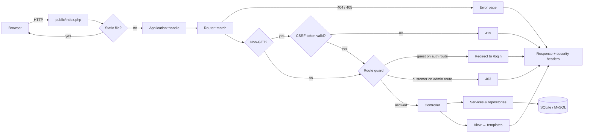
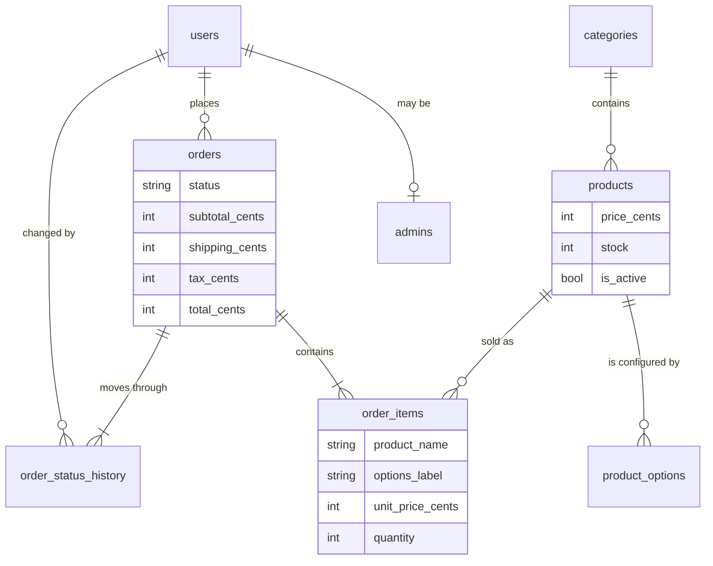

# Architecture

TechNest is a conventional server-rendered web application with no framework. This document
explains how a request flows through it, how the data is modelled, and why the less obvious
decisions were made the way they were.

## Request lifecycle

[`public/index.php`](../public/index.php) builds the configuration, database connection and
session, then hands a `Request` to [`Application::handle()`](../src/Application.php), which returns
a `Response`. Nothing below the front controller touches PHP's superglobals, which is what lets the
HTTP test suite run the entire application in-process with an in-memory session and database.

The two checks that matter most for security — CSRF and the route guard — run in `handle()`
before any controller is constructed. A controller cannot forget them, and the tests prove it by
enumerating the router's table rather than listing routes by hand.

Services are wired explicitly in `Application::services()` with a twenty-line
[`Container`](../src/Container.php): named factories, each run once per request. There is no
autowiring or reflection, so finding out where a dependency comes from means reading one method.

## Layers

| Layer | Responsibility | Examples |
|---|---|---|
| HTTP | Parse input, pick a controller, shape the response | `Request`, `Router`, `Response` |
| Controllers | Validate input, call one service, render or redirect | `CheckoutController`, `Admin\OrderController` |
| Services | Business rules that span tables, each in a transaction | `CheckoutService`, `OrderService`, `Auth` |
| Repositories | SQL, and hydrating rows into immutable objects | `ProductRepository`, `OrderRepository` |
| Domain values | Rules that need no database | `OrderStatus`, `PriceCalculator`, `OptionSelection`, `Money` |
| Views | Plain PHP templates with escaping helpers | `templates/`, `View` |

Domain objects (`Product`, `Order`, `User`, …) are `final` classes with `readonly` properties. They
are built from rows by the repositories through [`Row`](../src/Database/Row.php), which normalises
driver differences (SQLite returns integers, MySQL returns `SUM()` as a string) and throws on
anything unexpected instead of casting it to `0`.

## Data model

Plus `themes`, `login_attempts` and `migrations`. The full schema is in
[`database/migrations`](../database/migrations).

## Decisions

**No framework.** The point of the project is to show the mechanics — routing, sessions, CSRF,
transactions — rather than a framework's configuration of them. Composer is used only for
autoloading and development tools; the application has no runtime dependencies.

**Money in integer cents.** Floating point cannot represent most decimal prices exactly. Every
amount is an `int` of cents in PHP, in the database and in the session; `Money::parse()` turns an
admin's typed `1,199.99` into `119999` with string operations only.

**The session holds no prices.** The cart stores product ids, option ids and quantities. Prices are
read from the database whenever the cart is displayed and again inside the checkout transaction, so
there is nothing in client-controlled state that can change what an order costs. The same
re-pricing reconciles the cart with the catalog and reports what changed. The checkout form carries
a fingerprint of the lines, quantities, unit prices and total it showed; if the re-priced cart no
longer matches it, the order is not placed and the customer is sent back to the cart to see why.

**Order lines are snapshots.** `order_items` copies the product name, the chosen options as text,
and the unit price. Renaming or repricing a product later never rewrites a past order, and deleting
an option cannot orphan one.

**Archive, never delete.** Products that have been sold are referenced by order lines, so "delete"
is an `is_active` flag. The original version's hard delete either failed on the foreign key or would
have destroyed order history.

**Admin rights live in their own table.** `admins` records who granted the right and when, and
granting or revoking it never touches the user's row. An administrator cannot revoke their own
access or disable their own account, so the store cannot lose its last admin by accident.

**Two schema files, one set of queries.** SQLite and MySQL disagree on DDL (`AUTOINCREMENT` vs
`AUTO_INCREMENT`, `TEXT` vs `DATETIME`) but agree on the SQL the application runs, as long as it
avoids driver-specific functions. Timestamps are written by the application as UTC strings rather
than by database defaults, and `LIKE` searches escape wildcards with `!`, which both engines accept.
MySQL runs in strict mode with `ONLY_FULL_GROUP_BY`, the strictest common configuration.

**Stock is taken with a conditional update.** `UPDATE … WHERE stock >= ?` is atomic in both
engines, and its affected-row count says whether the stock was still there. That is enough to stop
overselling without explicit row locks. Rows are always updated in product-id order, by checkout and
by restocking alike, so two transactions touching the same products cannot deadlock on MySQL. The
admin product form follows the same rule from the other side: it writes stock only when the admin
changed it, and only if it still holds the figure the form showed, so saving a typo fix never puts
sold units back on sale.

**SQLite transactions take the write lock first.** PDO starts SQLite transactions as `DEFERRED`,
and a deferred transaction that has already read cannot become a writer while another connection is
writing: SQLite fails it immediately rather than waiting out `busy_timeout`. Every transaction here
reads before it writes, so `Database::transaction()` issues `BEGIN IMMEDIATE` on SQLite and
concurrent checkouts queue instead of failing.

**Server-rendered charts.** The dashboard's charts are SVG built in PHP. That avoids a charting
library, needs nothing from the Content-Security-Policy, prints correctly, and lets each theme's CSS
colour the bars.

**Themes as attribute-scoped tokens.** Each theme is a block of CSS custom properties under
`[data-theme="…"]`. Switching theme is one `UPDATE`, and because the tokens are scoped by attribute
rather than to `:root` alone, the admin page previews every theme side by side on one page.

## Testing

| Suite | What it covers | How |
|---|---|---|
| `tests/Unit` | Pure logic: money, pricing, the state machine, routing, CSRF, redirects, validation, charts | No database |
| `tests/Integration` | Repositories and services against a real database: checkout atomicity, restocking, throttling, reports, the seeder's consistency | A fresh in-memory SQLite database per test, or MySQL with `TEST_DB_DRIVER=mysql` |
| `tests/Http` | The whole application in-process: purchase flow, auth flow, admin actions, and security properties enumerated over the route table | `HttpTestCase` sends `Request` objects to `Application::handle()` |

Time is injected through a `Clock` interface, so throttling windows and reports are tested at a
fixed instant with `FrozenClock` rather than by sleeping.
